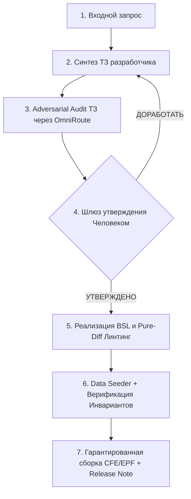

# Сквозной 7-шаговый пайплайн задачи (The Origami Pipeline)

> [!IMPORTANT]
> **Фундаментальный принцип:** «Спецификация первична, код вторичен».
> В разработке с участием ИИ узким местом является не скорость написания кода, а способность доказать, что код делает именно то, что нужно бизнесу, и не делает ничего лишнего.

---

## 1. Этап 1: Входной контракт (Что передает разработчик)
Разработчик формулирует задачу в чате или передает ссылку на материалы:
- **Роль:** `[Архитектор / Разработчик / Рефакторинг / Интеграция]`
- **Проблема:** Краткое описание боли пользователя или дефекта.
- **Материалы:** Ссылки на файлы, переписку, скриншоты (`@[path]`).

---

## 2. Этап 2: Синтез ТЗ разработчика (`ТЗ_Разработчика_<ID>.md`)
Агент формирует спецификацию по эталонному шаблону `templates/ТЗ_Разработчика.template.md`:
1. **Проблема и потребность бизнеса:** Что сломано / чего не хватает в терминах предметной области.
2. **Границы задачи (Scope):**
   * **In-Scope (Входит):** Что именно мы делаем.
   * **Out-of-Scope (НЕ ВХОДИТ):** Что мы явно исключаем, чтобы не раздувать задачу.
3. **Бизнес-Инварианты (Invariants):**
   * Неделимые аксиомы, которые код не имеет права нарушить ни при каких условиях (например: *«Документ Перемещение не может завершиться ошибкой проведения из-за отсутствия необязательных реквизитов»*).
4. **Критерии приемки (Definition of Done):** Точный список условий сдачи.
5. **Архитектурный выбор (ADR):** Таблица сравнения наивного подхода и Senior-решения со шпаргалкой для защиты.

---

## 3. Этап 3: Adversarial Audit ТЗ (Аудит рисков до кодинга)
- Агент отправляет ТЗ в модель-критик через OmniRoute (`python tools/premodel.py --task <путь_к_ТЗ>`):
  * Модель: **DeepSeek-R1** или **Claude 3.5 Sonnet** (`http://localhost:20128/v1`).
  * Вопрос: *«Найди 3 скрытых риска платформы 1С и архитектурных противоречия в этом ТЗ»*.
- Выявленные риски включаются в ТЗ до утверждения человеком.

---

## 4. Этап 4: Шлюз утверждения человеком (Human-in-the-Loop Gate)
> [!CAUTION]
> **Железное правило:** До получения явного согласия («ОК / Аппрув») переход к реализации кода **СТРОГО ЗАПРЕЩЕН**.

---

## 5. Этап 5: Реализация BSL и Pure-Diff Линтинг
- Разработка строго в рамках утвержденных границ расширения.
- Соблюдение корпоративных стандартов:
  * Длина строки $\le 120$ символов.
  * Запрет `ИЛИ` в `ГДЕ` запросов (заменять на `ОБЪЕДИНИТЬ ВСЕ`).
  * Запрет запросов в цикле и `ПолучитьОбъект()` в выборках.
  * Управляемые блокировки — строго `ИсточникДанных = ТаблицаДанных`.
  * Метки изменений: сохранение удаленного кода закомментированным (`// { - ... }`), запрет физического удаления чужого кода.
- **Гейты качества:** Автоформатирование `origami format <файл> --diff` и линтинг `origami lint <файл>`.

---

## 6. Этап 6: Data Seeder + Верификация на данных
1. **Data Seeder (`tools/seed_data.os`):** За 3 секунды через COM-соединение создает в локальной тестовой базе сквозную цепочку объектов под реквизитами с префиксом `_Тест_`.
2. **Верификация:** Проверка системы **строго по Бизнес-Инвариантам и Критериям приемки из ТЗ**, а не по коду.
3. Очистка созданных тестовых данных.

---

## 7. Этап 7: Сборка поставки и Release Note
1. Физическая сборка файла поставки: `.\tools\origami.ps1 check` и выгрузка `.cfe` / `.epf`.
2. Автоматическая генерация отчета о сдаче для ПланФикса / Заказчика:
   - Что сделано (In-Scope).
   - Как проверить на сервере разработки.
   - Какие объекты метаданных затронуты.
