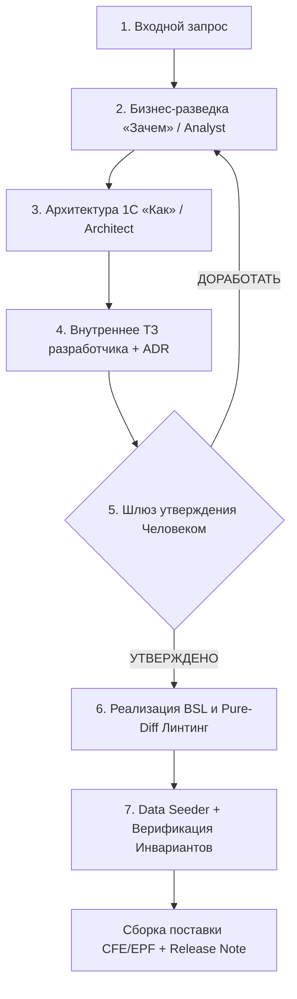

# Сквозной 7-шаговый пайплайн задачи (The Origami Pipeline)

> [!IMPORTANT]
> **Фундаментальный принцип:** «Сначала Зачем, затем Как. Спецификация первична, код вторичен».
> В разработке с участием ИИ узким местом является не скорость написания кода, а способность доказать, что код делает именно то, что нужно бизнесу, и не делает ничего лишнего. Доработка кодом допустима только при доказанной невозможности решения через штатный функционал платформы и БСП.

---

## 1. Этап 1: Входной контракт (Что передает разработчик)
Разработчик формулирует задачу в чате или передает ссылку на материалы:
- **Роль:** `[Архитектор / Разработчик / Рефакторинг / Интеграция]`
- **Проблема:** Краткое описание боли пользователя или дефекта.
- **Материалы:** Ссылки на файлы, переписку, скриншоты, стенограммы аудиозаписей (`@[path]`).

---

## 2. Этап 2: Бизнес-разведка «Зачем» (Pre-Modeling: Analyst)
Прежде чем приступать к коду или структуре метаданных, агент исследует суть проблемы:
1. **Декомпозиция бизнес-процесса:** Вскрыть физический жизненный цикл сущности, цепочку материальной ответственности и конфликт интересов сторон.
2. **Проверка типового функционала платформы и БСП (Zero-Code First):**
   - Проверить наличие штатных настроек, функциональных опций, прав и типовых профилей доступа БСП (`1c-bsp`), способных решить задачу без доработки конфигурации.
   - Проверить рекомендации стандартов разработки и документации ИТС.
3. **Экспертиза через OmniRoute:**
   - Запуск `.\tools\origami.ps1 premodel --task "<задача>" --role analyst`.
4. **Вопросы клиенту:** Сформулировать 3–5 точных вопросов Заказчику на понятном житейском языке без терминов 1С.

---

## 3. Этап 3: Архитектурное моделирование «Как» (Pre-Modeling: Architect)
Когда бизнес-контекст ясен, агент исследует техническую реализацию в 1С:
1. **Разведка метаданных через MCP:**
   - Анализ объектов, модулей и графа зависимостей (`1c-codemetadata`, `1c-graphmetadata`).
2. **Анализ системных рисков платформы:**
   - Управляемые транзакции, блокировки, RLS, расширения (CFE), влияние на производительность.
   - Запуск `.\tools\origami.ps1 premodel --task "<задача>" --role architect`.
3. **Архитектурный выбор (ADR):**
   - Формирование таблицы альтернатив (например: штатный профиль доступа vs подписка на событие в CFE).

---

## 4. Этап 4: Синтез Внутреннего ТЗ разработчика и Шлюз Человека
Агент формирует спецификацию по эталонному шаблону `templates/ТЗ_Разработчика.template.md`:
1. **Долгосрочная память задачи:** Внутреннее ТЗ (`ТЗ_Разработчика_<ID>.md`) фиксирует контекст, инварианты, границы Scope и обоснование принятого решения. Это позволяет возобновить работу над задачей через любое время без повторного исследования.
2. **Разграничение документов:** Внутреннее ТЗ разработчика (технический рабочий документ инженера) отделено от Клиентского ТЗ (внешний документ для заказчика без внутренних технических дискуссий).
3. **Шлюз утверждения человеком (Human-in-the-Loop Gate):**
   > [!CAUTION]
   > До получения явного согласия человека («ОК / Аппрув») переход к реализации кода **СТРОГО ЗАПРЕЩЕН**.

---

## 5. Этап 5: Реализация BSL и Pure-Diff Линтинг
- Разработка строго в рамках утвержденных границ расширения.
- Соблюдение 10 Железных ТАБУ Senior 1C (`1c-protocol.md`):
   * Длина строки $\le 120$ символов.
   * Запрет `ИЛИ` в `ГДЕ` запросов (заменять на `ОБЪЕДИНИТЬ ВСЕ`).
   * Запрет запросов в цикле и `ПолучитьОбъект()` в выборках.
   * Управляемые блокировки — строго `ИсточникДанных = ТаблицаДанных`.
   * Метки изменений: сохранение удаленного кода закомментированным (`// { - ... }`), запрет физического удаления чужого кода.
- **Гейты качества:** Автоформатирование `origami format <файл> --diff` и линтинг `origami lint <файл>`.

---

## 6. Этап 6: Data Seeder + Верификация на данных
1. **Data Seeder (`tools/seed_data.os`):** За 3 секунды через COM-соединение создает в локальной тестовой базе сквозную цепочку объектов под реквизитами с префиксом `_Тест_`.
2. **Верификация:** Проверка системы **строго по Бизнес-Инвариантам и Критериям приемки из ТЗ**, а не по коду.
3. Очистка созданных тестовых данных.

---

## 7. Этап 7: Сборка поставки и Release Note
1. Физическая сборка файла поставки: `.\tools\origami.ps1 check` и выгрузка `.cfe` / `.epf`.
2. Автоматическая генерация отчета о сдаче для ПланФикса / Заказчика:
   - Что сделано (In-Scope).
   - Как проверить на сервере разработки.
   - Какие объекты метаданных затронуты.
